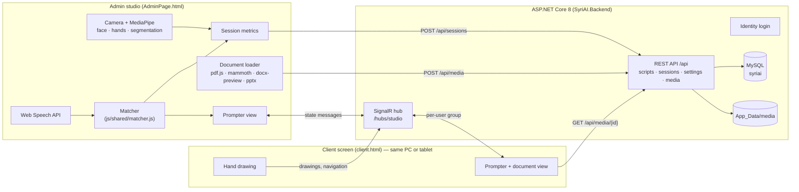

# SyriAI Studio — voice-tracking teleprompter for news presenters

SyriAI is a web-based teleprompter for news broadcasting, built as a Master's thesis project.
The script follows the presenter's voice instead of scrolling at a fixed speed: speech
recognition hears what is being read, and an Albanian-aware matcher finds that position in the
script and keeps it centred on screen. A second "client" screen (another tab, or a tablet on the
same network) shows the prompter to the presenter, with on-air graphics.

## Features

| Area | What it does |
|---|---|
| **Voice tracking** | Web Speech API (Chrome/Edge) + a custom matcher: diacritic-insensitive (ë→e, ç→c), tolerant to small recognition errors (edit distance), uses the preceding words as context, ignores repeated interim results. Voice commands: “fillo prompter” / “stop prompter”. |
| **Fallback modes** | Auto-scroll with adjustable speed, keyboard / presentation-remote navigation (← → Space PageUp/PageDown). |
| **Documents** | Load PDF, Word (.docx), PowerPoint (.pptx), images and video. Text is extracted into the script; the document is shown alongside, with the current word highlighted on small PDFs. |
| **YouTube output** | A 16:9 program page for OBS → YouTube Live: the studio's processed camera, LIVE bug, clock, headline and name straps, Breaking News ticker, documents next to the presenter, and "starting soon" / "thank you" slates with the countdown. The script is never shown to viewers. See [docs/YOUTUBE-LIVE.md](docs/YOUTUBE-LIVE.md). |
| **Client screen** | Real-time sync over SignalR (works across devices) with a BroadcastChannel fallback. Countdown, lower-third name banner, sponsor ticker, light/dark prompter theme, reading line, mirror mode for beam-splitter glass. |
| **Camera feedback** | MediaPipe Face Mesh: *gaze detection* (iris position between the eye corners + head yaw) and a simple *expression heuristic*. Selfie Segmentation for background blur / virtual studio. MediaPipe Hands for drawing on the screen with a finger. |
| **Sessions & evaluation** | Every LIVE session is measured (progress, words/minute, stalls, voice-match rate, processing time, face-visible and looking-at-camera time) and saved. Report with chart, CSV/JSON export, printable PDF, session history, participant/condition labels, the researcher's "lost place" count and a built-in SUS questionnaire for the user study. |
| **Accounts** | Registration with a 6-digit e-mail verification code, password reset by code, lockout after 5 wrong passwords, Albanian messages. Works without SMTP in development (codes appear in the terminal). See [docs/EMAIL.md](docs/EMAIL.md). |
| **Script library** | Save / open / delete scripts per user; the current draft is kept across reloads. |
| **Settings** | Countdown, speech language, ticker and sponsor texts, theme, reading line — stored per user. |

### Honest scope of the AI features

- **Gaze** is *detected*, not corrected: the video is never altered. The estimate is geometric
  (iris position and head yaw from face landmarks) with fixed thresholds, and it is not calibrated
  per person.
- **Expression** feedback is a rule on mouth-landmark ratios, not an emotion-recognition model.
- **Speech recognition** is the browser's cloud service (Chrome/Edge only, needs internet). SyriAI
  does the matching of recognised words to the script.

## Architecture



More detail (message protocol, data model, module layout): [docs/ARCHITECTURE.md](docs/ARCHITECTURE.md).

## Getting started

**Requirements:** .NET 8 SDK, Chrome or Edge, a webcam and microphone. Node.js 18+ only for
tests and the evaluation tool.

```bash
cd SyriAI.Backend

# One-time: MySQL database and connection string — see docs/DATABASE.md
brew install mysql && brew services start mysql
dotnet user-secrets set "ConnectionStrings:DefaultConnection" "Server=localhost;Port=3306;Database=syriai;User=syriai;Password=...;"

# One-time: the admin account is seeded from user-secrets (never from source code)
dotnet user-secrets set "SeedAdmin:Email" "you@example.com"
dotnet user-secrets set "SeedAdmin:Password" "choose-a-password"

dotnet run --launch-profile http
```

Open <http://localhost:5284>, log in, and the studio opens. Allow camera and microphone, then
click **Hap ekranin e klientit** to open the client screen.

The tables are created automatically on the first run (EF Core migrations). Data from the old
SQLite file can be copied once with `dotnet run -- import-sqlite app.db`.

### Client screen on another device (tablet, second laptop)

```bash
dotnet run --launch-profile lan
```

Then open `http://<this-computer's-IP>:5284/studio/client.html` on the other device and log in
with the same account. Browsers only allow camera access on `localhost` or HTTPS, so hand drawing
on a remote client needs HTTPS. The prompter itself works over HTTP.

### Troubleshooting

- **"Unable to connect to any of the specified MySQL hosts":** MySQL is not running. Start it with
  `brew services start mysql`.
- **macOS blocks `libe_sqlite3.dylib`:** the build folder came from a download. Run
  `xattr -dr com.apple.quarantine .` in the project folder, or delete `bin/` and `obj/` and build again.
- **Voice tracking does nothing:** use Chrome or Edge, allow the microphone, and check the
  internet connection (the browser's speech service is online).

## Tests and evaluation

```bash
npm test                          # unit tests: matcher + statistics (node:test, no dependencies)
npm run evaluate                  # new vs original matcher on simulated speech → tables + SVG figures
npm run analyze -- sessions.csv   # user-study statistics (Wilcoxon, medians, effect sizes) + SVG figures
```

Evaluation method, current results and the user-study protocol: [docs/EVALUATION.md](docs/EVALUATION.md).

## Project structure

```
SyriAI.Backend/
  Program.cs                 app setup: MySQL, layers, Identity, SignalR, admin seeding
  Entities/                  entity layer: tables + API request/response records
  DataAccess/                data access layer: DbContexts, repositories, migrations, SQLite importer
  Business/                  business layer: script/session/settings/media services, e-mail codes
  Controllers/               presentation: API controllers + SignalR hub (Razor pages in Areas/, Pages/)
  wwwroot/studio/
    AdminPage.html           admin studio
    client.html, client.js   presenter screen (prompter)
    broadcast.html/.css      YouTube / OBS program output (js/broadcast.js)
    style.css
    js/shared/               matcher.js · sync.js · documents.js (used by both pages)
    js/admin/                core · prompter · documents · session · library · settings ·
                             camera · recording · graphics · main
tests/                       matcher unit tests
tools/                       evaluate-matcher.js, legacy-matcher.js, analyze-study.js,
                             lib/ (statistics, SVG charts), results/
docs/                        ARCHITECTURE.md, DATABASE.md, EVALUATION.md, YOUTUBE-LIVE.md, EMAIL.md
```

## Technologies

ASP.NET Core 8 (Razor Pages, Identity, SignalR, API controllers), Entity Framework Core + MySQL (Pomelo),
vanilla JavaScript, Web Speech API, MediaPipe (Face Mesh, Hands, Selfie Segmentation), pdf.js,
mammoth, docx-preview, pptx-browser, JSZip.

## License

MIT — see [LICENSE](LICENSE).
