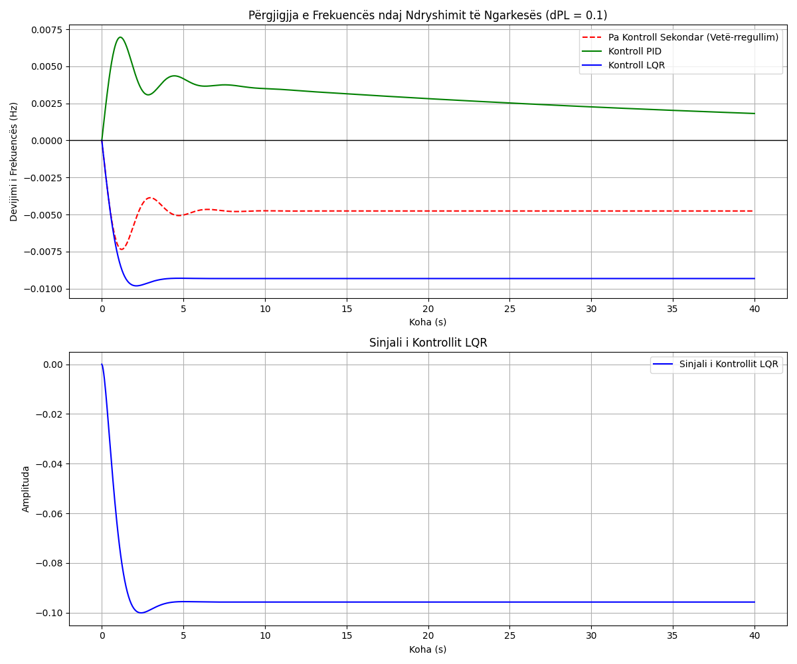

# Raport Teknik: Kontrolli i një Gjeneratori të Thjeshtë (LFC)
**Tema 18**

## 1. Hyrje
Ky projekt trajton modelimin dhe kontrollin e frekuencës së një gjeneratori elektrik (Load Frequency Control - LFC). Ruajtja e frekuencës në vlerat nominale (50 Hz ose 60 Hz) është kritike për stabilitetin e sistemit energjetik.

## 2. Modelimi Matematik
### 2.1 Ekuacionet Diferenciale
Sistemi përbëhet nga tri pjesë kryesore:
1.  **Gjeneratori (Inercia dhe Ngarkesa):**
    $M \frac{d\Delta f}{dt} = \Delta P_m - \Delta P_L - D \Delta f$
2.  **Turbina:**
    $T_t \frac{d\Delta P_m}{dt} = \Delta P_{gv} - \Delta P_m$
3.  **Rregullatori (Governor):**
    $T_g \frac{d\Delta P_{gv}}{dt} = u - \frac{1}{R} \Delta f - \Delta P_{gv}$

### 2.2 Funksioni i Transferimit (Transfer Function)
$G_p(s) = \frac{1}{Ms + D} \cdot \frac{1}{T_t s + 1} \cdot \frac{1}{T_g s + 1}$

### 2.3 Modeli në Hapësirën e Gjendjeve (State-Space)
$\dot{x} = Ax + Bu + F w$
$\Delta f = Cx$
Ku gjendjet janë: $x = [\Delta f, \Delta P_m, \Delta P_{gv}]^T$.

## 3. Analiza e Sistemit
### 3.1 Stabiliteti (Pole-Zero)
Poles e sistemit të hapur me feedback primar (droop) janë llogaritur si:
`[-5.89, -0.61 \pm 1.79j]`.
Të gjitha polet kanë pjesë reale negative, pra sistemi është stabil.

### 3.2 Step Response
Pa kontroll sekondar, një ndryshim në ngarkesë ($\Delta P_L$) rezulton në një gabim të përhershëm (steady-state error) të frekuencës.

## 4. Projektimi i Kontrollorit
### 4.1 Kontrollori PID
Është përdorur një kontrollor PID për të eliminuar gabimin e përhershëm:
$C(s) = K_p + \frac{K_i}{s} + K_d s$
Parametrat e zgjedhur: $K_p=2.0, K_i=0.5, K_d=0.1$.

### 4.2 Kontrollori LQR
Projektimi LQR minimizon funksionin e kostos:
$J = \int_0^\infty (x^T Q x + u^T R u) dt$
Me $Q = diag(10, 1, 1)$ dhe $R = 1$.
Matrica e fitimit u llogarit si: $K = [-0.7, 0.45, 0.54]$.

## 5. Rezultatet dhe Simulimet
Simulimet janë kryer në Python duke përdorur librarinë `control`. Rezultatet tregojnë:
*   **PID:** Eliminon plotësisht gabimin, por ka një tejkalim (overshoot) fillestar.
*   **LQR:** Ofron përgjigje më të shpejtë dhe më të qetë (më pak oscilime).

## 6. Diskutim dhe Krahasime
Performanca e LQR është superiore në aspektin e kohës së qetësimit (settling time) dhe minimizimit të devijimeve, ndërsa PID është më i thjeshtë për implementim në sisteme reale pa nevojë për matjen e të gjitha gjendjeve.

## 7. Përfundime
Projekti vërteton se kontrolli sekondar është i domosdoshëm për stabilitetin e frekuencës dhe se metodat moderne (LQR) ofrojnë performancë më të mirë se ato klasike (PID) në kushte ideale.
