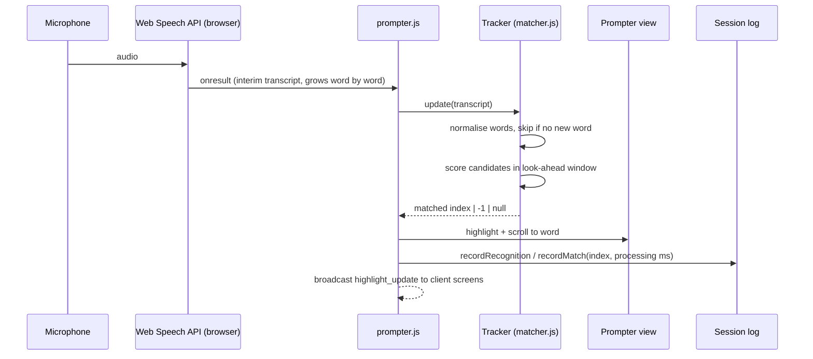
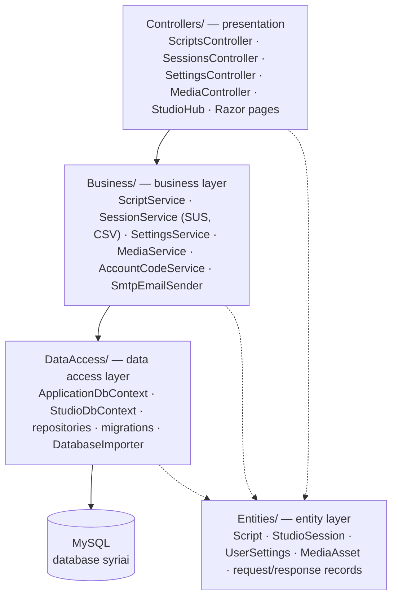
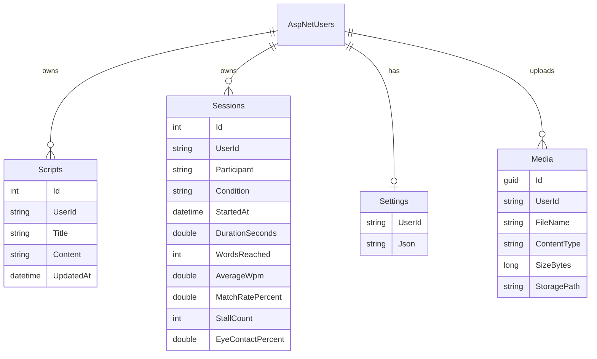

# SyriAI Studio — architecture

## Components

| Component | Technology | Responsibility |
|---|---|---|
| Admin studio | `AdminPage.html` + `js/admin/*.js` | Script editing, speech tracking, documents, camera AI, recording, session measurement |
| Client screen | `client.html` + `client.js` | Shows the prompter / document to the presenter, on-air graphics, hand drawing |
| Broadcast output | `broadcast.html` + `broadcast.css` + `js/broadcast.js` | 1920×1080 program output for OBS → YouTube: processed camera (drawn from the studio window's canvas via `window.opener`), graphics, slates |
| Shared browser modules | `js/shared/*.js` | `matcher.js` (speech → script), `sync.js` (messaging), `documents.js` (rendering) |
| Backend | ASP.NET Core 8, 3-tier (see [Backend layers](#backend-layers)) | Login (Identity), REST API controllers, SignalR hub, media storage |
| Database | MySQL via EF Core (Pomelo provider) | Users (Identity) and studio data (scripts, sessions, settings, media index) |

The browser code is plain JavaScript without a build step. Admin modules are classic scripts that
share one global scope and are loaded in dependency order (see the end of `AdminPage.html`):
`core → prompter → documents → session → library → settings → camera → recording → graphics → main`.
`matcher.js` is written as a UMD module so the same file runs in the browser and in Node (tests,
evaluation).

## Speech tracking pipeline

**Matching rules** (`js/shared/matcher.js`):

1. Normalise: lowercase, Unicode NFD and remove combining marks (ë→e, ç→c), remove punctuation.
2. Look at the most recent spoken word; search `lookAhead` (25) script words from the current position.
3. Score each candidate: exact = 1, near = 0.8 (1 edit, or 2 edits for 8+ letters, minimum 4
   letters), shared 4-letter stem = 0.5. Add +1 per preceding spoken word that also lines up
   with the script (up to 2), and subtract 0.01 per word of distance so the nearest one wins ties.
4. Words shorter than 3 letters (e, në, të…) are only accepted with context.
5. A weak (stem-only) guess more than 5 words ahead is rejected.
6. Interim transcripts that bring no new word are ignored. Chrome resends the whole sentence
   on every update, and re-matching it would jump to later repeats of the same word.

## Real-time sync

`StudioSync` (`js/shared/sync.js`) sends `(type, data)` messages:

- **Online:** SignalR hub `/hubs/studio` (`Controllers/StudioHub.cs`). Requires login. Each user has a
  private group; a message goes to the sender's *other* connections (`OthersInGroup`).
- **Fallback:** `BroadcastChannel('syriai_sync')` when the hub is unreachable (e.g. static hosting).
  It only reaches tabs of the same browser.
- Messages sent before the connection is ready are queued (max 200).
- A client sends `client_ready` on every (re)connect; the admin answers with the full state.

Media is never sent through the sync channel. The admin uploads the file (`POST /api/media`) and
sends its URL; each screen downloads and renders it itself.

### Message protocol

| Type | Direction | Payload |
|---|---|---|
| `client_ready` | client → admin | — |
| `script_update` | admin → client | `{ html }` rendered script (HTML-escaped words) |
| `highlight_update` | admin → client | word index |
| `pdf_word_highlight` | admin → client | `{ page, nx, ny, nw, nh }` normalised word box |
| `font_size` | admin → client | rem value |
| `settings_sync` | admin → client | `{ theme, readingLine, sponsors, fontSize, mirror }` |
| `media_sync` | admin → client | `{ kind: pdf\|word\|pptx\|image\|video, url, name }` |
| `view_mode` | admin → client | `'text'` \| `'doc'` |
| `autoscroll_sync` / `scroll_speed_sync` | admin → client | boolean / number |
| `countdown` | admin → client | seconds left (0 hides it) |
| `live_state` | admin → broadcast | `{ live, ended }` → LIVE bug, "starting soon" / "thank you" slate |
| `headline_sync` | admin → broadcast | `{ show, text }` headline strap |
| `doc_scroll_ratio` | admin → broadcast | 0–1 relative document scroll (the output's document box has another size) |
| `lt_sync` | both | `{ show, name, title }` lower-third banner |
| `text_scroll` / `pdf_scroll` | both | scrollTop in px |
| `cursor_pos` | both | `{ nx, ny, visible }` normalised pointer |
| `draw_segment` | both | `{ x1, y1, x2, y2, color }` normalised line |
| `clear_draw` | both | `true` |
| `nav_next` / `nav_prev` | client → admin | — |

## Backend

### Backend layers

The backend follows a three-tier architecture. The layers are folders in the one
`SyriAI.Backend` project, and each layer only calls the layer below it:

| Layer | Folder | Responsibility |
|---|---|---|
| Entity | `Entities/` | Table classes and the API's request/response shapes (`ScriptInput`, `SessionSummary`, …). No logic. |
| Data access | `DataAccess/` | EF Core contexts and one repository per table (`IScriptRepository`, …). Only reads and writes rows, always filtered by user. |
| Business | `Business/` | Rules: validation, ownership, SUS score, CSV export, file whitelist and storage, e-mail codes. Returns `ServiceResult<T>` (Ok / NotFound / Invalid). |
| Presentation | `Controllers/` | `[ApiController]` classes that map HTTP to business calls and `ServiceResult` to `200/201/204/400/404`; the SignalR hub; Razor pages for login. |

Dependencies are registered in `Program.cs` (repositories and services are scoped per request).
Errors from the business layer are returned as `{ "error": "…" }`, the shape the studio pages read.

### REST API (`Controllers/StudioControllers.cs`) — all endpoints require login and are scoped to the user

| Method | Path | Purpose |
|---|---|---|
| GET / POST | `/api/scripts` | list / create scripts |
| GET / PUT / DELETE | `/api/scripts/{id}` | read / update / delete a script |
| GET / POST | `/api/sessions` | list / save session metrics |
| PATCH | `/api/sessions/{id}` | add study data: observer "lost place" count, SUS answers (score computed on the server), notes |
| DELETE | `/api/sessions/{id}` | delete a session |
| GET | `/api/sessions/export.csv` | all sessions as CSV (UTF-8 BOM, formula-injection safe) |
| GET / PUT | `/api/settings` | per-user settings JSON (≤ 64 KB) |
| POST | `/api/media` | upload (whitelisted types, ≤ 250 MB) |
| GET | `/api/media/{id}` | download, with range requests for video seeking |

API and hub calls without a valid login get `401` instead of a redirect to the login page.

### Data model

Studio tables belong to `StudioDbContext`, which has its own migrations
(`DataAccess/Migrations/Studio`, history table `__StudioMigrationsHistory`). The Identity tables
belong to `ApplicationDbContext` (`DataAccess/Migrations/Identity`). Both are applied on start-up.
`UserId` is stored without a database foreign key because the two contexts are separate.
Setup, the SQLite import and backups: [DATABASE.md](DATABASE.md).

## Design decisions

| Decision | Reason |
|---|---|
| SignalR instead of only BroadcastChannel | Client screens on other devices; per-user isolation; automatic reconnect. |
| Media by URL, not by message | Messages stay small (8 MB hub limit); a client that connects late still gets the document; video can be seeked. |
| Separate `StudioDbContext` | Login tables and studio tables evolve independently, each with its own migrations. |
| MySQL instead of SQLite | A client-server database: several users and devices at the same time, standard tooling (backups, MySQL Workbench). The old `app.db` is copied once with `import-sqlite`. |
| Three layers (Entities, DataAccess, Business, Controllers) | Each part has one job and can be tested or replaced alone, e.g. the repositories could move to another database without touching the rules. |
| No front-end build step | Keeps the thesis project easy to run and inspect; the shared matcher is still unit-testable in Node. |
| Admin seeded from configuration | No credentials in source control (`dotnet user-secrets`). |

## Known limitations

- Speech recognition depends on Chrome/Edge's online service; latency and accuracy of that service
  are outside the application's control and are not included in the "processing time" metric.
- Gaze thresholds are fixed and not calibrated per person or camera position.
- Remote client screens need HTTPS for their own camera (hand drawing).
- MediaPipe models run on the admin computer's CPU/GPU; slow machines lower the frame rate.
