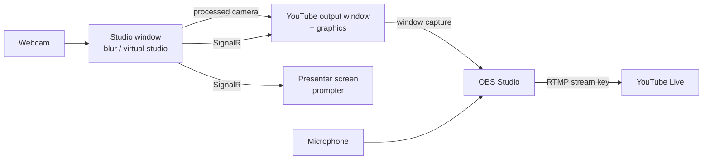

# Going live on YouTube with SyriAI

SyriAI uses three screens, each with its own job:

| Window | Who sees it | What it shows |
|---|---|---|
| **Studio** (`AdminPage.html`) | operator | all controls, prompter, camera preview |
| **Presenter screen** (*Ekrani i prezantuesit*, `client.html`) | presenter | prompter text, synced to the voice |
| **YouTube output** (*Dalja për YouTube*, `broadcast.html`) | viewers | camera + on-air graphics, never the script |

The YouTube output is a 16:9 page designed for 1920×1080. OBS captures that window and streams
it to YouTube.

## One-time setup

1. **YouTube:** in YouTube Studio → *Create* → *Go live* → *Stream*, copy the **stream key**.
   (New channels must wait up to 24 h after enabling live streaming.)
2. **OBS Studio** (free, <https://obsproject.com>):
   - *Settings → Stream*: service **YouTube – RTMPS**, paste the stream key.
   - *Settings → Video*: base and output resolution **1920×1080**, **30 fps**.
   - *Settings → Output*: video bitrate **4500–6000 Kbps**, audio 160 Kbps.
3. **macOS permissions:** *System Settings → Privacy & Security → Screen Recording* and
   *Microphone* → allow OBS.

## Before each show

1. Start SyriAI (`dotnet run --launch-profile http`) and open the studio in **Chrome**.
2. Click **Dalja për YouTube**. A 16:9 window opens with the "starting soon" slate. Keep it
   **open and uncovered**. Chrome pauses drawing in covered windows. A second monitor is ideal.
   Double-click inside it for full screen.
3. Click **Ekrani i prezantuesit** and put that window where the presenter reads, e.g. a monitor or
   tablet next to the camera, or the teleprompter glass.
4. In OBS add sources:
   - **Window Capture** (macOS: *macOS Screen Capture → Window*) → the window
     "SyriAI — Dalja për transmetim". Crop or stretch it to fill the 1920×1080 canvas.
   - **Audio Input Capture** → your microphone. The browser window's sound is not captured,
     so the voice goes to OBS directly.
5. Fill in the on-air graphics in the studio: **headline** (*Titulli i lajmit → Shfaq titullin*),
   presenter **name** (*Shfaq banerin*), and the **ticker** texts (⚙ Settings).

## Going live

1. In OBS press **Start Streaming**. Viewers see the "Transmetimi fillon së shpejti" slate with the
   headline.
2. In the studio press **Fillo LIVE**. The countdown (3-2-1) appears on the stream, then the camera
   with the graphics and the **LIVE** bug.
3. During the show:
   - switch to **Dokument** to show the uploaded photo, video, PDF or slides: by default as a
     **split screen** (camera on the left half, document on the right half). Switch back to
     **Tekst** to return to the full-screen camera. In ⚙ Settings → *Dokumentet në transmetimin
     YouTube* you can choose a small window over the camera instead;
   - show or hide the headline and name straps as needed.
4. Press **Ndalo**. The stream shows "Faleminderit që na ndoqët". Stop streaming in OBS after a
   few seconds.

## Tips

- **Camera effects** (blur / virtual studio) appear on the stream because the output window
  draws the studio's processed camera. If the output window is opened directly (not with the
  button), it uses the raw webcam instead.
- **Covered windows stop updating.** If the stream freezes when another window is in front, keep
  the output window visible, or start Chrome with `--disable-backgrounding-occluded-windows`.
- **Test privately first:** in YouTube Studio set the stream to *Unlisted* and do a full dry run.
- **Record locally too:** OBS can record while streaming (*Settings → Output → Recording*). You get
  a clean copy for your thesis defence.
